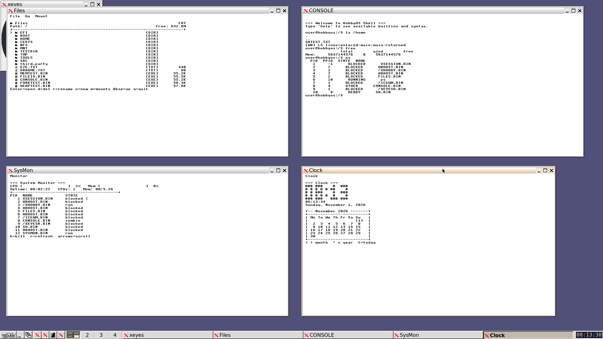
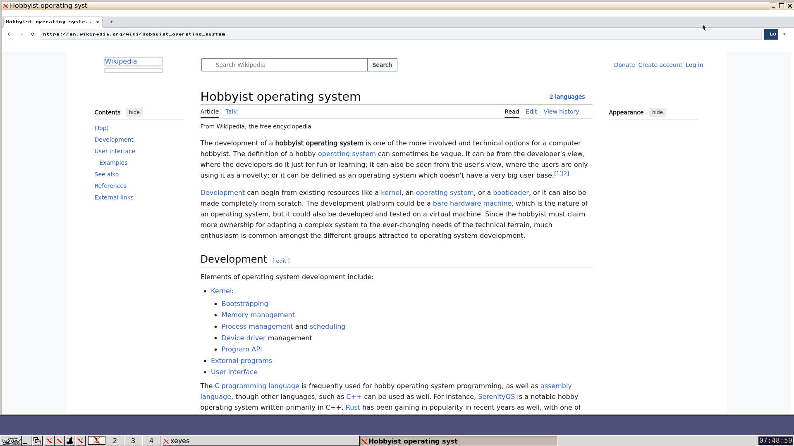
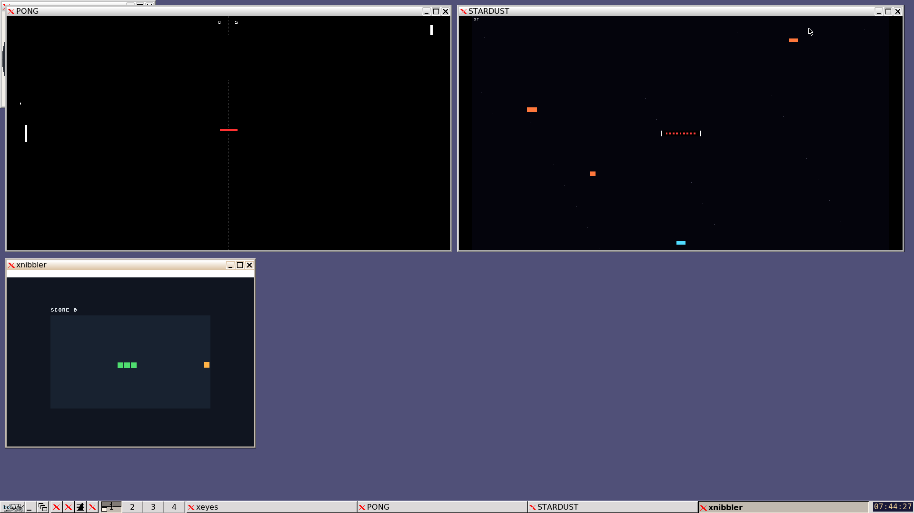
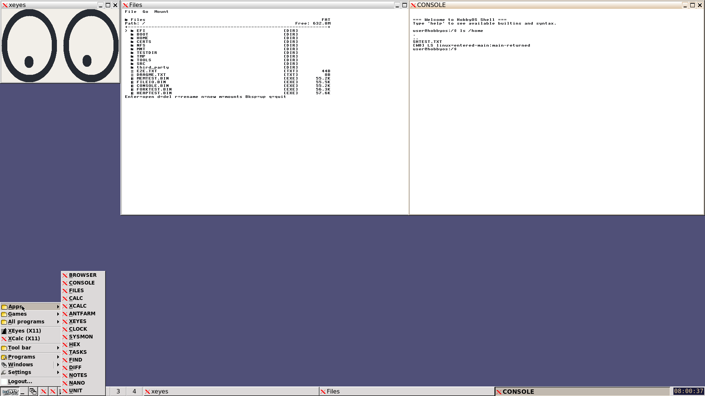
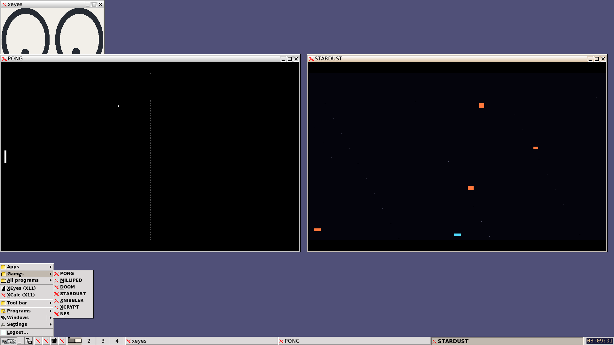
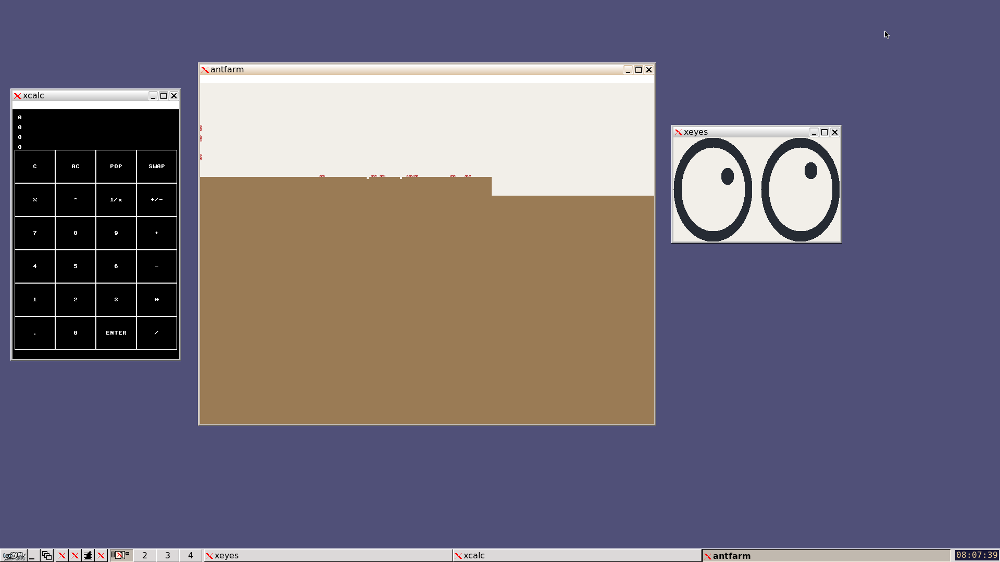
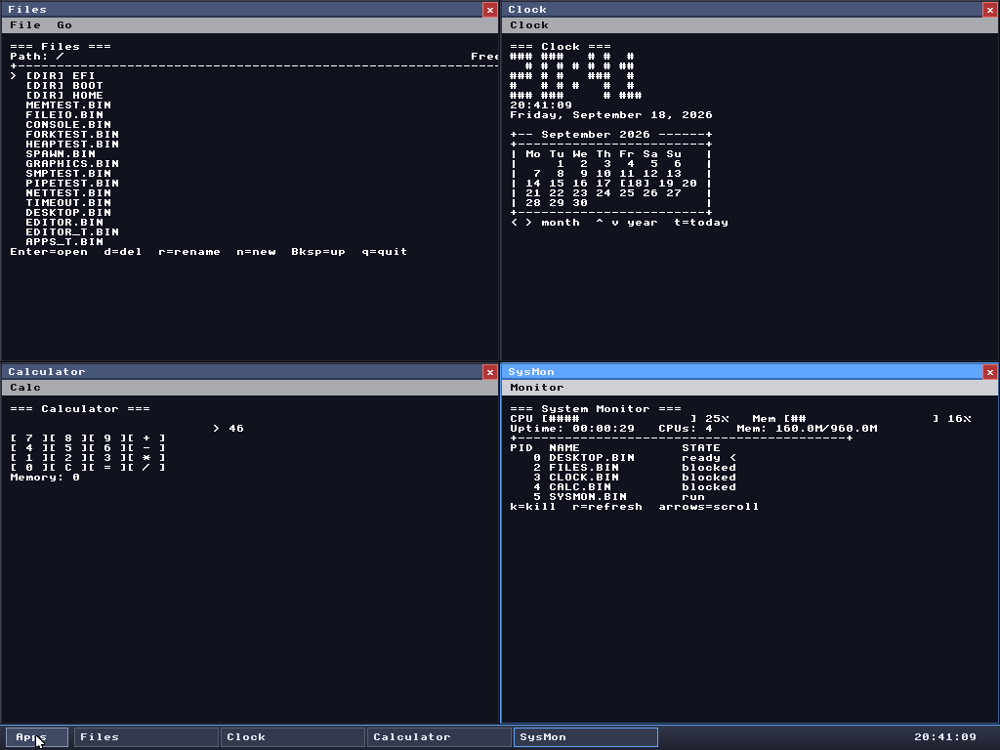

# HobbyOS

A from-scratch 64-bit hobby operating system in C — ARM64 primary, x86_64 secondary — booting bare-metal in QEMU to an **X11 desktop**: an X.Org-derived X server (`XHOBBY.BIN`) with a HobbyOS DDX driving the framebuffer, **[IceWM](https://github.com/bbidulock/icewm)** as the window manager, and the desktop applications, arcade games and WebKit browser each running in a real managed window (`HBHOST.BIN` hosts the native pixel-window apps; `XCALC` and `XEYES` are true Xlib clients). Under the hood: a preemptive SMP kernel, a POSIX-flavoured libc and shell, a read-only NFSv3 client, and an in-OS LLVM toolchain.

## Screenshots

| | |
|---|---|
|  |  |
| **The desktop** — IceWM managing FILES, CONSOLE (`ls /home`, `free`, `ps`), SYSMON and CLOCK, each a real window with a title bar, and the taskbar below | **The browser** — the WebKit port rendering a live Wikipedia article, fetched over TLS from inside the guest |
|  |  |
| **Games** — PONG, STARDUST and XNIBBLER as user-space programs, each scaled into its own IceWM window | **The start menu** — Apps, Games and All programs, generated from the desktop's pinned lists at disk-build time |
|  |  |
| **Games menu** — the pinned games plus anything in `/GAMES`, launched into a window through `HBHOST.BIN` | **X11 clients** — XCALC computing through clicks on real Xlib, ANTFARM animating on the native graphics API, XEYES following the pointer |

*Captured from a live QEMU boot — [`capture_screenshots.py`](capture_screenshots.py) reproduces them.*

## Setup

HobbyOS builds and runs on **macOS** and **Linux**. Both need the same three
kinds of host tool:

| | what | why |
|---|---|---|
| **LLVM 21+** | `clang`, `ld.lld`, `llvm-objcopy`, `llvm-ar` | the kernel, the libc and every userland `.BIN` are compiled and linked with LLVM |
| **QEMU 10+** | `qemu-system-aarch64`, `qemu-system-x86_64` and UEFI firmware for both | the OS only ever runs bare-metal under QEMU — it boots through EDK2/OVMF, not `-kernel` |
| **FAT tools** | `mkfs.fat`, `mcopy`, `mmd`, `mdir`, `mdeltree` | `disk.img` is a FAT-16 image assembled on the host and handed to the guest as a real disk |

The default `make run` (the IceWM desktop) additionally cross-builds a vendored
X.Org + IceWM stack the first time, which needs `meson`, `ninja`, `cmake`,
`xkbcomp` plus the `xkeyboard-config` data, and a host C compiler. The test
tiers (`make host_tests`, `make test`) do not need any of that — but
`make host_tests` runs a ccache cold-vs-warm measurement, so it does want
`ccache` on the PATH.

### macOS (Homebrew)

```bash
# 1. Homebrew, if you do not have it
/bin/bash -c "$(curl -fsSL https://raw.githubusercontent.com/Homebrew/install/HEAD/install.sh)"

# 2. LLVM (clang + LLD), QEMU, and the FAT tooling
brew install llvm lld qemu dosfstools mtools

# 3. host tools for the X11/IceWM desktop build, plus the harness helpers
brew install meson ninja cmake xkbcomp xkeyboard-config
brew install ccache xz socat python@3
```

The Makefile points straight at `/opt/homebrew/opt/llvm/bin` and
`/opt/homebrew/sbin/mkfs.fat`, so no PATH juggling is needed for `make`. Two
things the IceWM build does look up through the environment on macOS (the X
keyboard data lives under the Homebrew prefix, not `/usr/share/X11/xkb`):

```bash
export XKB_CONFIG_ROOT="$(brew --prefix)/share/X11/xkb"   # for third_party/x11/build.sh
export PATH="/opt/homebrew/opt/llvm/bin:$PATH"            # for scripts that call clang/llvm-* by name
```

Homebrew's `qemu` ships the EDK2 firmware the Makefile expects
(`/opt/homebrew/share/qemu/edk2-aarch64-code.fd`,
`edk2-x86_64-code.fd`), so there is nothing else to install for booting.

### Linux (Debian / Ubuntu)

```bash
sudo apt update
sudo apt install -y clang lld llvm ccache            # LLVM 21+ (Ubuntu 26.04 ships 21)
sudo apt install -y qemu-system-arm qemu-system-x86 qemu-efi-aarch64 ovmf
sudo apt install -y dosfstools mtools
sudo apt install -y meson ninja-build cmake x11-xkb-utils xkb-data
sudo apt install -y build-essential git make perl python3
sudo apt install -y curl xz-utils unzip socat
```

Debian and Ubuntu install the LLVM binaries with a version suffix
(`clang-21`, `ld.lld-21`, `llvm-objcopy-21`) while the Makefile calls the
unsuffixed names, so put the LLVM bin directory on your PATH:

```bash
export PATH="/usr/lib/llvm-21/bin:$PATH"     # add to ~/.profile; use the version you installed
```

On Fedora: `sudo dnf install clang lld llvm ccache qemu-system-aarch64
qemu-system-x86 edk2-aarch64 edk2-ovmf dosfstools mtools meson ninja-build cmake
xkbcomp xkeyboard-config curl xz unzip socat python3 perl`. On Arch:
`sudo pacman -S clang lld llvm ccache qemu-full edk2-armvirt edk2-ovmf dosfstools
mtools meson ninja cmake xorg-xkbcomp xkeyboard-config curl xz unzip socat python
perl`.

The Linux branch of the Makefile reads its UEFI firmware from two fixed paths
under `$HOME`, so copy (or symlink) the distro's files there once:

```bash
mkdir -p ~/.local/share/OVMF ~/.local/share/AAVMF
cp  /usr/share/OVMF/OVMF_CODE_4M.fd  ~/.local/share/OVMF/OVMF_CODE_4M.fd
cp -L /usr/share/AAVMF/AAVMF_CODE.fd ~/.local/share/AAVMF/AAVMF_CODE.fd
```

`cp -L` matters: the distro file is a symlink to `AAVMF_CODE.no-secboot.fd`, and
a secure-boot image will refuse to boot Limine. `make run ARCH=intel` (the
default) needs only the OVMF file; `ARCH=arm` needs the AAVMF one.

### Verify the installation

```bash
clang --version                # 21.x
ld.lld --version
llvm-objcopy --version
qemu-system-aarch64 --version  # 10.x
qemu-system-x86_64 --version
mkfs.fat --version && mcopy --version
```

Then the fast host-side gate — it compiles and runs the host golden tests with
no QEMU involved:

```bash
make host_tests
```

## Build

```bash
make                  # kernel + userland + disk.img (ARCH=intel, DESKTOP=icewm)
make ARCH=arm         # the ARM64 image instead
```

A full build:

- compiles the kernel from `src/kernel/` with Clang and links it with `ld.lld`,
- compiles every user-space program in `src/user/` — the desktop apps, the shell
  and the GNU-style tools, the arcade games, the test programs,
- assembles the FAT-16 `disk.img` that carries the kernel, all the `.BIN`s, the
  WebKit browser, and — for the IceWM desktop — the X server, IceWM, the
  `HBHOST.BIN` window host and the `/X11`, `/ICEWM` data trees.

The first IceWM build also downloads the pinned X.Org / IceWM / fontconfig
tarballs into `third_party/x11/dl/`, checks them against
`third_party/x11/sums/`, and cross-builds them into
`third_party/x11/build/<arch>/` (that takes a while once; later builds reuse
it). `X11_BUILD_DIR=<dir>` points the build at a prebuilt tree instead.

| target | what it does |
|---|---|
| `make` | everything, default `ARCH=intel` + `DESKTOP=icewm` |
| `make ARCH=arm` | the same for ARM64 |
| `make hobbyos.elf` | just the kernel |
| `make disk.img` | just the FAT-16 disk image (needs the userland) |
| `make host_tests` | host-side golden tests (fast, no QEMU) |
| `make clean` | remove `obj/`, `disk.img`, the ELFs and any running QEMU |

### Clean Build Artifacts

Remove all compiled files and start fresh:

```bash
make clean
```

`make clean` also kills a leftover QEMU. Switching `ARCH` or `MODE` normally
rebuilds what it needs by itself (stamp files under `obj/<arch>/`), so a clean
is rarely required.

## Run

```bash
make run                 # x86_64/KVM, IceWM desktop — the default
make run ARCH=arm        # ARM64 under TCG (much slower, same desktop)
```

That launches QEMU with:

- `qemu-system-x86_64 -M q35` + OVMF for `ARCH=intel` (the default), or
  `qemu-system-aarch64 -M virt -cpu cortex-a53` + AAVMF for `ARCH=arm`,
- 12 GiB of RAM and 8 vCPUs on x86_64, 16 GiB on ARM (`QEMU_SMP=` overrides the
  core count; the guest caps at 8),
- the disk image as a real disk — NVMe on q35, virtio-blk on virt,
- user-mode networking (`10.0.2.x`, host reachable at `10.0.2.2`) and a
  virtio-gpu display,
- the kernel's serial console on stdio.

Extra QEMU flags go through `QEMU_ARGS`, e.g. a headless boot with a QMP socket
for scripted screenshots (the serial console stays on stdout, so tee it):

```bash
make run QEMU_ARGS="-display none -qmp unix:./qmp-sock,server,nowait" | tee serial.log
```

### QEMU Controls

- Close the QEMU window (or `pkill -f qemu-system`) to stop the OS.
- In a `-nographic` session, press `Ctrl+A` then `X` to exit QEMU.

### Desktop: IceWM (default) or the original HobbyOS desktop (`DESKTOP=hobby`)

`make run` boots into an X11 session managed by
[IceWM](https://github.com/bbidulock/icewm). The original native HobbyOS
desktop is still available with `DESKTOP=hobby`. The plan and status are in
`icewm.md`.

```bash
make run                            # IceWM, intel (default ARCH)
make run ARCH=arm                   # IceWM, ARM64 (TCG, slow)
make run DESKTOP=hobby              # the original HobbyOS desktop
make run DESKTOP=hobby ARCH=arm
```

`DESKTOP` only matters for the interactive desktop boot (`MODE=desktop`, the
default). The test tiers (`make test`, `unit_tests`, `desktop_test`,
`apps_test`, ...) default to `DESKTOP=hobby`, and the native-desktop QMP
harnesses (`run_*_test.py`) pass `DESKTOP=hobby` themselves, so none of them
needs the X stack.

| |
|---|
|  |
| **`DESKTOP=hobby`** — the original native desktop: its own window manager, tiling, and the Apps menu, with no X server involved |

With `DESKTOP=icewm`:
- the kernel is built with `-DKERNEL_DESKTOP_ICEWM` and launches `XSESSION.BIN`
  (`src/user/x11sess/`) instead of `DESKTOP.BIN`;
- the disk also gets the X server `XHOBBY.BIN`, `ICEWM.BIN`, `ICEWMBG.BIN` and
  the `/X11`, `/ICEWM` data trees from `X11_BUILD_DIR` (default
  `third_party/x11/build/<arch>`). If those binaries are missing, the build runs
  `third_party/x11/build.sh --arch <arch> --stage all` (this takes a while the
  first time). `X11_BUILD_DIR=<dir>` uses a prebuilt tree instead.
- `XSESSION.BIN` sets `DISPLAY=:0`, `HOME`, `FONTCONFIG_FILE=/X11/FONTS.CNF` and
  `PATH`, plus any `KEY=VALUE` lines in `/X11/XSESSION.ENV`. It starts the X
  server, waits for it (with a time limit), and then starts IceWM. If the X
  server or IceWM exits, or never starts, it falls back to the normal HobbyOS
  desktop. The serial log shows each step on lines starting with `[XSESS]`.

What you get: the X.Org-based server `XHOBBY.BIN` (hw/hobbyos DDX), IceWM 4.1.0 with its
taskbar, start menu, toolbar and workspaces, and two real-Xlib demo clients (XEyes,
XCalc). The start menu mirrors the HobbyOS desktop's Apps menu: **Apps** (the desktop's
pinned apps — BROWSER, CONSOLE, FILES, CALC, XCALC, ANTFARM, XEYES, CLOCK, SYSMON, HEX,
TASKS, FIND, DIFF, NOTES, NANO, UNIT), **Games** (PONG, MILLIPED, DOOM, STARDUST,
XNIBBLER, XCRYPT, NES and anything in `/GAMES`) and **All programs** (every other `.BIN`
on the disk). These native programs run in normal IceWM windows through `HBHOST.BIN`
(`src/user/hbhost/`), which gives each one a private framebuffer and input queue (the
kernel's virtual display) and draws its window exactly as the HobbyOS desktop would; the
games show their whole screen scaled into the window. The toolbar has CONSOLE, FILES,
XEyes and XCalc. Close a window with IceWM's X button or F4. The menu is generated when
`disk.img` is built (`src/user/x11sess/gen-icewm-menu.sh`), from `desktop.c`'s pinned
lists and the files on that disk. Details: `icewm.md` §9.
The children's stdout/stderr appear on the serial console as `[X] ...` lines.
IceWM's Logout ends the session and drops you to the HobbyOS desktop.

First build: `third_party/x11/build.sh` downloads the pinned X.Org/IceWM/fontconfig
tarballs into `third_party/x11/dl/` and checks each sha256 (`third_party/x11/sums/`).
This is the only extra network access the IceWM desktop needs (the build already
fetches the llvm-project and ICU sources the same way on a fresh checkout). Host tools:
meson, ninja, cmake, xkbcomp and xkb-data.

`HBHOST.BIN` is rebuilt by `make` whenever the desktop/window code it shares changes; it
links the X client libraries from `X11_PREFIX` (default `$(X11_BUILD_DIR)/prefix`; point
it at a shared prefix when the build dir has none).

Switching `DESKTOP` rebuilds the kernel's `main.o` and `disk.img`
(stamp file `obj/<arch>/.desktop`).

Headless test (QMP screenshots in `/tmp/hobbyos_icewm_<arch>/`):
```bash
make icewm_test                                   # real X stack: taskbar, start menu, CONSOLE + XCALC via HBHOST
make icewm_test ICEWM_TEST_ARGS=--stubs           # launcher + fallback with stub X binaries
make icewm-stubs && make run X11_BUILD_DIR=obj/intel/x11stub
```

## Graphics acceleration

QEMU launches through a single `QEMU_GPU` switch (see the launcher design in
`docs/graphics-accel.md` §3-D5):

- `auto` (default) — use the accelerated path only when a real interactive
  display is in play: `MODE=desktop` **and** `DISPLAY` is set **and**
  `QEMU_ARGS` does not force `-display none`. On ARM that means
  `-device virtio-gpu-gl-device` + `-display gtk,gl=on` (host GL via
  llvmpipe counts as accelerated). Everything else resolves to soft.
- `soft` — always the plain 2D path: `virtio-gpu-device` + the plain
  `gtk` display (or `-display none`).
- `gl` — force the accelerated path. It is only valid when the display
  backend actually has OpenGL support, so combining it with a
  `-display none` override fails by design (QEMU rejects the GL device —
  e.g. don't combine it with the `run_*.py` headless overrides).

```bash
make run                     # ARM desktop: GL device + gtk,gl=on when possible
make run QEMU_GPU=soft       # force the plain 2D path
make gpu-check               # probe this host; prints which mode auto picks
```

On x86_64 the guest still drives Bochs std-VGA (the x64 virtio-gpu driver
lands separately); `QEMU_GPU` switches only the display backend there for
now. `make gpu-check` probes both arches, shows why `egl-headless` and
gl-with-`-display none` are excluded, and prints the mode `auto` will pick
for the current invocation (it is harmless without `DISPLAY`).

**Headless tiers stay on the plain device.** QMP `screendump` — what every
`run_*.py` E2E and the CI VM rely on — has no surface under a `gtk,gl=on`
window. `test`/`unit_tests`/`desktop_test` modes append `-display none` and
resolve to `soft` automatically, as does any `make run` with a `-display
none` override, so those paths behave exactly as before. To verify a GL
boot interactively, capture the X11 window instead:
`xwininfo -root -tree | grep -i qemu`, then `import -window <id> shot.png`.

## NFS (read-only NFSv3 client)

The kernel can mount NFSv3 exports over UDP and route path-based syscalls
into them. The client is deliberately read-only — `GETATTR`, `LOOKUP`,
`READ`, `READDIRPLUS`, `FSSTAT` plus `MOUNT`/`UMNT` and portmapper
`GETPORT` — so mounts are presented read-only and mutation syscalls
(`unlink`, `rename`, `mkdir`, writes) fail on them.

Under QEMU's user-mode networking the guest reaches the host at `10.0.2.2`,
so a Linux `nfs-kernel-server` on the host is directly mountable:

```bash
# Host: export a directory (UDP/NFSv3, insecure source ports)
sudo apt-get install -y nfs-kernel-server
sudo mkdir -p /srv/nfs/export && echo "hello" | sudo tee /srv/nfs/export/HELLO.TXT
echo '/srv/nfs/export *(rw,sync,no_subtree_check,insecure,no_root_squash)' \
    | sudo tee /etc/exports
sudo exportfs -ra && sudo systemctl restart nfs-server
```

```
# In the HobbyOS shell (SH.BIN / the Console app):
mount                              # list active NFS mounts
mount 10.0.2.2:/srv/nfs/export /nfs   # mount an export (point auto-created)
ls /nfs                            # listings, reads, cd work through the VFS
umount /nfs                        # unmount (open handles fail cleanly after)
```

The Files app integrates the same syscalls: its **Mount** menu mounts and
unmounts exports, a Mounts view lists them, and browsing into a mount shows
the `[NFS]` badge with the server's free space (`FSSTAT`).

New syscalls (both architectures): `SYS_MOUNT` (27) and `SYS_UMOUNT` (28);
`sysinfo(8, ...)` returns a snapshot of the mount table and `sysinfo(7, ...)`
reports the statistics of the filesystem holding the cwd (NFS `FSSTAT` when
inside a mount).

Where it lives:

- `src/kernel/nfs_proto.c` — pure XDR/RPC/NFSv3 codecs (no I/O; compiled
  into the kernel *and* the host test suite)
- `src/kernel/nfs.c` — RPC transport over UDP sockets, mount table,
  directory cache, read operations
- `src/kernel/vfs.c` — path canonicalisation and FAT16/NFS routing
- `src/user/nfs_test.c` — in-OS integration test (`MODE=test`)

Tests:

- `make host_tests` — includes `nfs_proto_test_host`, which replays real
  nfsd datagrams captured by `tools/capture_nfs_fixtures.py` into
  `src/host/nfs_fixtures.h` (catches protocol misunderstandings that
  hand-written fixtures would codify)
- `./run_unit_tests.sh` / `./run_unit_tests_intel.sh` — EL1 unit tests for
  the codecs, mount-table API and VFS dispatch on both architectures
- `make test` — boots `MODE=test`; `NFSTEST.BIN` mounts the host export and
  checks listings, byte-exact reads (including a 10 000-byte chunked file
  and a 20-entry multi-batch directory), FSSTAT, read-only enforcement and
  unmount behaviour. Run the host NFS server first or the e2e tier reports
  `SKIP e2e` and the run still passes.

## Project Structure

```
HobbyOS/
├── src/
│   ├── kernel/            # kernel: mm, scheduler, VFS, FAT16/NFS, net, POSIX layer
│   │   ├── main.c         # entry point; KERNEL_DESKTOP_ICEWM selects the session
│   │   ├── arch/{arm,x64}/ # boot, traps, MMU, per-arch syscall entry
│   │   └── vdisplay.c     # per-process virtual framebuffer + input queues
│   ├── include/           # kernel headers (syscall ABI, fs, process, vdisplay)
│   ├── libc/              # libc, libc++ runtime and the POSIX headers
│   ├── user/              # user-space programs
│   │   ├── x11sess/       # XSESSION.BIN: starts the X server + IceWM, menu generator
│   │   ├── hbhost/        # HBHOST.BIN: hosts a native app inside an X window
│   │   ├── doom/ nes/ rogue/ …            # game ports (PONG, MILLIPED, STARDUST,
│   │   │                                  #  XNIBBLER and XCRYPT are single files)
│   │   ├── files.c console.c calc.c sysmon.c clock.c hex.c tasks.c …  # desktop apps
│   │   ├── desktop.c      # the native DESKTOP.BIN (DESKTOP=hobby) and its pinned lists
│   │   ├── sh.c ls.c grep/ sed/ nano/ …   # the shell and the GNU-style tools
│   │   ├── browser/       # the WebKit port's HobbyOS toolchain glue
│   │   └── *_test.c       # in-OS integration tests (MODE=test)
│   ├── host/              # host-side golden tests (make host_tests)
│   └── user_include/      # headers shared by userland apps (libc.h, gui.h, files.h …)
├── third_party/
│   ├── x11/               # cross-build of X.Org + IceWM + client libs (build.sh)
│   ├── llvm-21.1.8/       # in-OS clang/lld staging for /TOOLS
│   └── webkit-hobbyos/    # the WebKit port that becomes /BROWSER.BIN
├── docs/                  # design docs: browser, desktop, fs, selfhost, graphics
├── tools/                 # harnesses: QMP drivers, screenshot tools, CI helpers
├── capture_screenshots.py # regenerates the screenshots on this page
├── run_icewm_test.py      # headless IceWM gate (taskbar, menu, HBHOST clients)
├── Makefile               # build configuration
└── README.md              # this file
```

## License

Copyright 2026 Sarah Kaylor

GNU GENERAL PUBLIC LICENSE
Version 2, June 1991

Copyright (C) 1989, 1991 Free Software Foundation, Inc.  
<https://fsf.org/>
Everyone is permitted to copy and distribute verbatim copies
of this license document, but changing it is not allowed.
Preamble
The licenses for most software are designed to take away your freedom to share and change it. By contrast, the GNU General Public License is intended to guarantee your freedom to share and change free software--to make sure the software is free for all its users. This General Public License applies to most of the Free Software Foundation's software and to any other program whose authors commit to using it. (Some other Free Software Foundation software is covered by the GNU Lesser General Public License instead.) You can apply it to your programs, too.

When we speak of free software, we are referring to freedom, not price. Our General Public Licenses are designed to make sure that you have the freedom to distribute copies of free software (and charge for this service if you wish), that you receive source code or can get it if you want it, that you can change the software or use pieces of it in new free programs; and that you know you can do these things.

To protect your rights, we need to make restrictions that forbid anyone to deny you these rights or to ask you to surrender the rights. These restrictions translate to certain responsibilities for you if you distribute copies of the software, or if you modify it.

For example, if you distribute copies of such a program, whether gratis or for a fee, you must give the recipients all the rights that you have. You must make sure that they, too, receive or can get the source code. And you must show them these terms so they know their rights.

We protect your rights with two steps: (1) copyright the software, and (2) offer you this license which gives you legal permission to copy, distribute and/or modify the software.

Also, for each author's protection and ours, we want to make certain that everyone understands that there is no warranty for this free software. If the software is modified by someone else and passed on, we want its recipients to know that what they have is not the original, so that any problems introduced by others will not reflect on the original authors' reputations.

Finally, any free program is threatened constantly by software patents. We wish to avoid the danger that redistributors of a free program will individually obtain patent licenses, in effect making the program proprietary. To prevent this, we have made it clear that any patent must be licensed for everyone's free use or not licensed at all.

The precise terms and conditions for copying, distribution and modification follow.

TERMS AND CONDITIONS FOR COPYING, DISTRIBUTION AND MODIFICATION
0. This License applies to any program or other work which contains a notice placed by the copyright holder saying it may be distributed under the terms of this General Public License. The "Program", below, refers to any such program or work, and a "work based on the Program" means either the Program or any derivative work under copyright law: that is to say, a work containing the Program or a portion of it, either verbatim or with modifications and/or translated into another language. (Hereinafter, translation is included without limitation in the term "modification".) Each licensee is addressed as "you".

Activities other than copying, distribution and modification are not covered by this License; they are outside its scope. The act of running the Program is not restricted, and the output from the Program is covered only if its contents constitute a work based on the Program (independent of having been made by running the Program). Whether that is true depends on what the Program does.

1. You may copy and distribute verbatim copies of the Program's source code as you receive it, in any medium, provided that you conspicuously and appropriately publish on each copy an appropriate copyright notice and disclaimer of warranty; keep intact all the notices that refer to this License and to the absence of any warranty; and give any other recipients of the Program a copy of this License along with the Program.

You may charge a fee for the physical act of transferring a copy, and you may at your option offer warranty protection in exchange for a fee.

2. You may modify your copy or copies of the Program or any portion of it, thus forming a work based on the Program, and copy and distribute such modifications or work under the terms of Section 1 above, provided that you also meet all of these conditions:

a) You must cause the modified files to carry prominent notices stating that you changed the files and the date of any change.
b) You must cause any work that you distribute or publish, that in whole or in part contains or is derived from the Program or any part thereof, to be licensed as a whole at no charge to all third parties under the terms of this License.
c) If the modified program normally reads commands interactively when run, you must cause it, when started running for such interactive use in the most ordinary way, to print or display an announcement including an appropriate copyright notice and a notice that there is no warranty (or else, saying that you provide a warranty) and that users may redistribute the program under these conditions, and telling the user how to view a copy of this License. (Exception: if the Program itself is interactive but does not normally print such an announcement, your work based on the Program is not required to print an announcement.)
These requirements apply to the modified work as a whole. If identifiable sections of that work are not derived from the Program, and can be reasonably considered independent and separate works in themselves, then this License, and its terms, do not apply to those sections when you distribute them as separate works. But when you distribute the same sections as part of a whole which is a work based on the Program, the distribution of the whole must be on the terms of this License, whose permissions for other licensees extend to the entire whole, and thus to each and every part regardless of who wrote it.

Thus, it is not the intent of this section to claim rights or contest your rights to work written entirely by you; rather, the intent is to exercise the right to control the distribution of derivative or collective works based on the Program.

In addition, mere aggregation of another work not based on the Program with the Program (or with a work based on the Program) on a volume of a storage or distribution medium does not bring the other work under the scope of this License.

3. You may copy and distribute the Program (or a work based on it, under Section 2) in object code or executable form under the terms of Sections 1 and 2 above provided that you also do one of the following:

a) Accompany it with the complete corresponding machine-readable source code, which must be distributed under the terms of Sections 1 and 2 above on a medium customarily used for software interchange; or,
b) Accompany it with a written offer, valid for at least three years, to give any third party, for a charge no more than your cost of physically performing source distribution, a complete machine-readable copy of the corresponding source code, to be distributed under the terms of Sections 1 and 2 above on a medium customarily used for software interchange; or,
c) Accompany it with the information you received as to the offer to distribute corresponding source code. (This alternative is allowed only for noncommercial distribution and only if you received the program in object code or executable form with such an offer, in accord with Subsection b above.)
The source code for a work means the preferred form of the work for making modifications to it. For an executable work, complete source code means all the source code for all modules it contains, plus any associated interface definition files, plus the scripts used to control compilation and installation of the executable. However, as a special exception, the source code distributed need not include anything that is normally distributed (in either source or binary form) with the major components (compiler, kernel, and so on) of the operating system on which the executable runs, unless that component itself accompanies the executable.

If distribution of executable or object code is made by offering access to copy from a designated place, then offering equivalent access to copy the source code from the same place counts as distribution of the source code, even though third parties are not compelled to copy the source along with the object code.

4. You may not copy, modify, sublicense, or distribute the Program except as expressly provided under this License. Any attempt otherwise to copy, modify, sublicense or distribute the Program is void, and will automatically terminate your rights under this License. However, parties who have received copies, or rights, from you under this License will not have their licenses terminated so long as such parties remain in full compliance.

5. You are not required to accept this License, since you have not signed it. However, nothing else grants you permission to modify or distribute the Program or its derivative works. These actions are prohibited by law if you do not accept this License. Therefore, by modifying or distributing the Program (or any work based on the Program), you indicate your acceptance of this License to do so, and all its terms and conditions for copying, distributing or modifying the Program or works based on it.

6. Each time you redistribute the Program (or any work based on the Program), the recipient automatically receives a license from the original licensor to copy, distribute or modify the Program subject to these terms and conditions. You may not impose any further restrictions on the recipients' exercise of the rights granted herein. You are not responsible for enforcing compliance by third parties to this License.

7. If, as a consequence of a court judgment or allegation of patent infringement or for any other reason (not limited to patent issues), conditions are imposed on you (whether by court order, agreement or otherwise) that contradict the conditions of this License, they do not excuse you from the conditions of this License. If you cannot distribute so as to satisfy simultaneously your obligations under this License and any other pertinent obligations, then as a consequence you may not distribute the Program at all. For example, if a patent license would not permit royalty-free redistribution of the Program by all those who receive copies directly or indirectly through you, then the only way you could satisfy both it and this License would be to refrain entirely from distribution of the Program.

If any portion of this section is held invalid or unenforceable under any particular circumstance, the balance of the section is intended to apply and the section as a whole is intended to apply in other circumstances.

It is not the purpose of this section to induce you to infringe any patents or other property right claims or to contest validity of any such claims; this section has the sole purpose of protecting the integrity of the free software distribution system, which is implemented by public license practices. Many people have made generous contributions to the wide range of software distributed through that system in reliance on consistent application of that system; it is up to the author/donor to decide if he or she is willing to distribute software through any other system and a licensee cannot impose that choice.

This section is intended to make thoroughly clear what is believed to be a consequence of the rest of this License.

8. If the distribution and/or use of the Program is restricted in certain countries either by patents or by copyrighted interfaces, the original copyright holder who places the Program under this License may add an explicit geographical distribution limitation excluding those countries, so that distribution is permitted only in or among countries not thus excluded. In such case, this License incorporates the limitation as if written in the body of this License.

9. The Free Software Foundation may publish revised and/or new versions of the General Public License from time to time. Such new versions will be similar in spirit to the present version, but may differ in detail to address new problems or concerns.

Each version is given a distinguishing version number. If the Program specifies a version number of this License which applies to it and "any later version", you have the option of following the terms and conditions either of that version or of any later version published by the Free Software Foundation. If the Program does not specify a version number of this License, you may choose any version ever published by the Free Software Foundation.

10. If you wish to incorporate parts of the Program into other free programs whose distribution conditions are different, write to the author to ask for permission. For software which is copyrighted by the Free Software Foundation, write to the Free Software Foundation; we sometimes make exceptions for this. Our decision will be guided by the two goals of preserving the free status of all derivatives of our free software and of promoting the sharing and reuse of software generally.

NO WARRANTY

11. BECAUSE THE PROGRAM IS LICENSED FREE OF CHARGE, THERE IS NO WARRANTY FOR THE PROGRAM, TO THE EXTENT PERMITTED BY APPLICABLE LAW. EXCEPT WHEN OTHERWISE STATED IN WRITING THE COPYRIGHT HOLDERS AND/OR OTHER PARTIES PROVIDE THE PROGRAM "AS IS" WITHOUT WARRANTY OF ANY KIND, EITHER EXPRESSED OR IMPLIED, INCLUDING, BUT NOT LIMITED TO, THE IMPLIED WARRANTIES OF MERCHANTABILITY AND FITNESS FOR A PARTICULAR PURPOSE. THE ENTIRE RISK AS TO THE QUALITY AND PERFORMANCE OF THE PROGRAM IS WITH YOU. SHOULD THE PROGRAM PROVE DEFECTIVE, YOU ASSUME THE COST OF ALL NECESSARY SERVICING, REPAIR OR CORRECTION.

12. IN NO EVENT UNLESS REQUIRED BY APPLICABLE LAW OR AGREED TO IN WRITING WILL ANY COPYRIGHT HOLDER, OR ANY OTHER PARTY WHO MAY MODIFY AND/OR REDISTRIBUTE THE PROGRAM AS PERMITTED ABOVE, BE LIABLE TO YOU FOR DAMAGES, INCLUDING ANY GENERAL, SPECIAL, INCIDENTAL OR CONSEQUENTIAL DAMAGES ARISING OUT OF THE USE OR INABILITY TO USE THE PROGRAM (INCLUDING BUT NOT LIMITED TO LOSS OF DATA OR DATA BEING RENDERED INACCURATE OR LOSSES SUSTAINED BY YOU OR THIRD PARTIES OR A FAILURE OF THE PROGRAM TO OPERATE WITH ANY OTHER PROGRAMS), EVEN IF SUCH HOLDER OR OTHER PARTY HAS BEEN ADVISED OF THE POSSIBILITY OF SUCH DAMAGES.

END OF TERMS AND CONDITIONS
How to Apply These Terms to Your New Programs
If you develop a new program, and you want it to be of the greatest possible use to the public, the best way to achieve this is to make it free software which everyone can redistribute and change under these terms.

To do so, attach the following notices to the program. It is safest to attach them to the start of each source file to most effectively convey the exclusion of warranty; and each file should have at least the "copyright" line and a pointer to where the full notice is found.

one line to give the program's name and an idea of what it does.
Copyright (C) yyyy  name of author

This program is free software; you can redistribute it and/or
modify it under the terms of the GNU General Public License
as published by the Free Software Foundation; either version 2
of the License, or (at your option) any later version.

This program is distributed in the hope that it will be useful,
but WITHOUT ANY WARRANTY; without even the implied warranty of
MERCHANTABILITY or FITNESS FOR A PARTICULAR PURPOSE.  See the
GNU General Public License for more details.

You should have received a copy of the GNU General Public License
along with this program; if not, see
<https://www.gnu.org/licenses/>.
Also add information on how to contact you by electronic and paper mail.

If the program is interactive, make it output a short notice like this when it starts in an interactive mode:

Gnomovision version 69, Copyright (C) year name of author
Gnomovision comes with ABSOLUTELY NO WARRANTY; for details
type `show w'.  This is free software, and you are welcome
to redistribute it under certain conditions; type `show c' 
for details.
The hypothetical commands `show w' and `show c' should show the appropriate parts of the General Public License. Of course, the commands you use may be called something other than `show w' and `show c'; they could even be mouse-clicks or menu items--whatever suits your program.

You should also get your employer (if you work as a programmer) or your school, if any, to sign a "copyright disclaimer" for the program, if necessary. Here is a sample; alter the names:

Yoyodyne, Inc., hereby disclaims all copyright
interest in the program `Gnomovision'
(which makes passes at compilers) written 
by James Hacker.

signature of Moe Ghoul, 1 April 1989
Moe Ghoul, President of Vice
This General Public License does not permit incorporating your program into proprietary programs. If your program is a subroutine library, you may consider it more useful to permit linking proprietary applications with the library. If this is what you want to do, use the GNU Lesser General Public License instead of this License.
